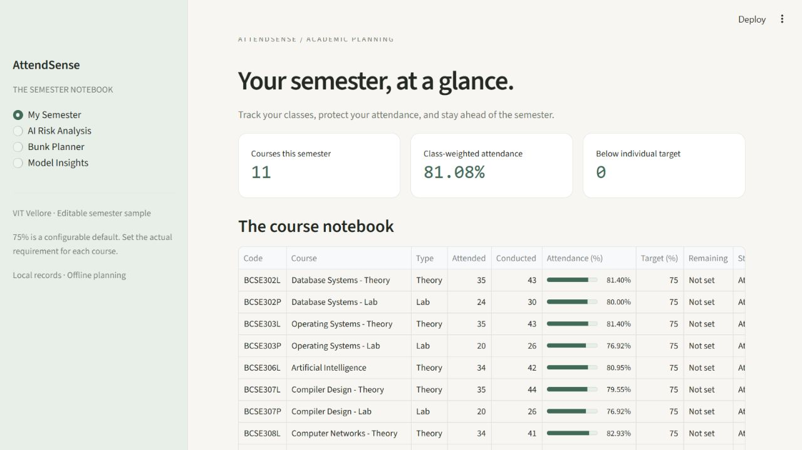

# AttendSense

A local student attendance notebook for tracking classes, calculating absence
allowances, and exploring future attendance. Built for an AI course case study at
VIT Vellore with Python, Streamlit, pandas, NumPy, scikit-learn and ReportLab.

**Use mathematics for certainty, machine learning for uncertainty, and transparency for both.**

## Run locally

Python 3.11+ is required (verified here with Python 3.13). From this project folder:

```bash
pip install -r requirements.txt
python -m src.generate_data
python -m src.train
python -m src.report
python -m pytest -q
streamlit run app.py
```

Open the local URL printed by Streamlit, usually http://localhost:8501. Generated
dataset, model, metrics, charts and report are included, so routine launches need
only `streamlit run app.py` after installing dependencies. If the Streamlit command
is not on PATH, use `python -m streamlit run app.py`. Commands work from the root
on Windows. All application paths resolve relative to the source, not the shell.
The app runs offline after dependencies are installed. System fonts are used when
DM Sans / DM Mono are unavailable; no remote font service is required.

## Four connected screens

- **My Semester:** 11 exact editable demo records, weighted overview, per-course
  targets, course selection, adding, editing, deleting and local persistence.
- **AI Risk Analysis:** select from 300 held-out synthetic student-subject records,
  filter by simulated behaviour, inspect past attendance, and see the trained model's
  shortage estimate immediately. Exact 0%/100% outcomes take priority. Reveal the
  simulated final outcome separately for evaluation. Personal semester records are
  not read by this screen.
- **Bunk Planner:** adjust remaining and planned attended classes; see exact final
  attendance and the target line update immediately. Scenarios do not alter records.
- **Model Insights:** browse and download all 1,500 synthetic records, filter by
  training/test partition, and inspect actual metrics, model comparison, confusion
  matrix, global permutation importance, limitations and the faculty PDF.

## Planning semantics

Targets are configured per subject; 75% is a default, not an institutional claim.
Remaining classes initially show **Not set** for every supplied course. Projections
and final absence allowances stay unavailable until a remaining count is entered.

**Safe bunks now** is the number of consecutive upcoming misses that keeps current
attendance at target immediately afterward. It uses only counts and the target; it
is a mathematical count capacity, not a guarantee those classes are scheduled.
**Future absence allowance** is the number of classes you may miss among the known
remaining classes while attending enough of the rest to finish at target. Impossible
recovery shows no allowance. Zero conducted classes means undefined percentage.
Zero total scheduled classes cannot support an ML prediction or final percentage.
Exact fraction arithmetic handles target equality before display rounding.

## Records and privacy

`data/semester_subjects.json` stores only course details and counts. Atomic saves
preserve edits across Streamlit reruns. Invalid changes are rejected. Deletion
requires confirmation. Reset requires confirmation and creates a timestamped `.bak`
copy before restoring the sample. A JSON backup download is available. Corrupt files
are reported and preserved; they are never automatically reset. To recover, close
the app, copy the desired backup over the JSON file, and restart. The app is a
single-user local tool; concurrent edits from multiple processes are not supported.
The model demonstration derives its trends from synthetic past event sequences.
Your editable semester courses are used only for tracking and exact planning.
There is no authentication, VTOP login, scraping, cloud backend or LLM API.

## The AI experiment

**Synthetic educational dataset, not actual VIT student records.**

The 1,500 independent trajectories simulate six behaviour families. All features
come from the past snapshot or known schedule. Future events determine the label
and are excluded from input. Real semester records never enter model training.
See [DATASET.md](DATASET.md) for distributions, definitions and limitations.

The 80/20 stratified split reserves 300 test records. Preprocessing is fitted inside
training folds. A five-fold training CV F2 score selects among DummyClassifier,
Logistic Regression and Random Forest. The actual selected model is **Logistic
Regression**; the requested forest remains a fully evaluated candidate. Its slightly
higher mean CV F2 is not evidence of statistically significant superiority.

| Model | Test accuracy | Precision | Recall | F1 | ROC-AUC |
|---|---:|---:|---:|---:|---:|
| Logistic Regression (selected) | 0.880 | 0.888 | 0.877 | 0.882 | 0.960 |

This table records the executed seed-42 run; the app and PDF read saved metrics
directly. `models/metrics.json` includes every candidate, CV means and variability,
test confusion matrices, feature importance, seed, sklearn version and dataset hash.
Regenerating with different library versions can change results slightly; review
the saved metrics after retraining. The model artifact is a trusted local Joblib
file; do not replace it with an untrusted downloaded pickle.

Predictions have **not been validated on actual university student records**.
Probabilities are not calibrated. The 30% and 70% category boundaries are illustrative.
Global permutation importance describes overall model behaviour, not the cause of
an individual prediction. Exact feasibility checks remain authoritative.

## Verified interface



This is a genuine browser capture of the running local app. The layout was also
checked at a 390-pixel mobile viewport, with collapsible navigation and a scrollable
course table.

## Outputs and layout

```text
app.py                       Four-screen Streamlit application
src/attendance.py            Exact arithmetic and certainty checks
src/subjects.py              Validated atomic JSON storage and sample data
src/generate_data.py         Reproducible event simulation
src/train.py                 Pipelines, CV selection, evaluation and charts
src/predict.py               Trained inference with mathematical safeguards
src/synthetic.py             Verified synthetic data and train/test membership
src/report.py                Six-page academic report generation
tests/                       Arithmetic, storage, data/model and app workflow tests
data/synthetic_attendance.csv
data/semester_subjects.json
models/attendance_model.joblib
models/metrics.json
outputs/confusion_matrix.png
outputs/model_comparison.png
outputs/feature_importance.png
outputs/class_distribution.png
reports/AttendSense_Case_Study.pdf
```

Regeneration overwrites synthetic data, model, metric, chart and PDF artifacts; it
does not change semester records. Tests isolate storage in workspace scratch
folders and never edit your live semester file. The report has the five faculty
sections across six pages and uses actual executed metrics and figures, with
verified UCI and Breiman references. Its semester examples are explicitly the
supplied sample, not a copy of subsequent personal edits.
